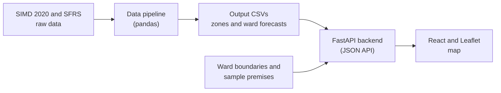
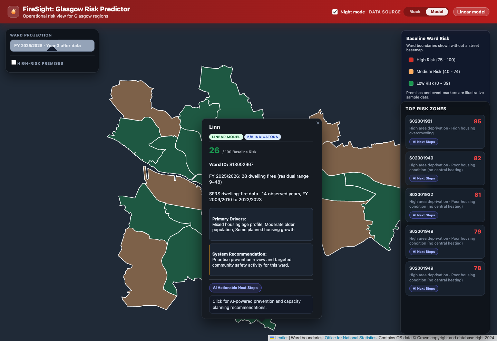

# Fire Sight

[](https://github.com/yehorm14/fire-sight/actions/workflows/ci.yml)


A Glasgow fire-risk map for fire and rescue planners: ward risk scores, dwelling-fire forecasts and plain-language explanations.

## The problem

Fire services cannot visit every home, so home fire safety visits have to go where they will help most. Fire risk is not spread evenly: it follows factors such as deprivation, overcrowding, poor heating and health vulnerability, and it changes over time. Fire Sight combines SIMD 2020 area indicators with Scottish Fire and Rescue Service dwelling-fire counts to score every Glasgow DataZone, forecast dwelling fires for each ward, and explain the result in plain language so planners can decide where to focus.

## Why it is useful

- Shows where to focus home fire safety visits, ranked by deprivation, housing and health indicators.
- Projects annual dwelling-fire counts for each ward from 14 financial years of Scottish Fire and Rescue Service records.
- Turns the numbers into three action points per ward, zone or premises.

## Features

- Map of the 23 Glasgow City wards coloured by baseline risk, with ward projections for FY 2023/2024, 2024/2025 and 2025/2026.
- Mock or Model data source toggle; Model uses the pipeline scores and forecasts.
- Ranked list of the highest-risk DataZones (746 scored).
- Overlays for 14 illustrative city-centre premises and sample large events.
- "Explain" panel using OpenAI when a key is set, template text otherwise.
- Night mode.

## How it works

The data pipeline (`data-pipeline/`) turns SIMD 2020 and SFRS fire statistics into CSVs. The FastAPI backend (`backend/`) loads them with the ward and premises files and serves JSON. The React and Leaflet frontend (`frontend/fire_website/`) draws the map. Pipeline details: [docs/PIPELINE.md](docs/PIPELINE.md).



To see a projection, choose **Model**, open a ward on the map and select a financial year under **Ward projection**. The open popup updates the projected dwelling-fire count and residual range. The baseline risk colour stays fixed when switching years. The last observed financial year is 2022/2023.



The default dashboard shows the ward boundaries with no external basemap.

The Mock source and the premises and event overlays use illustrative sample data, not real premises or incidents. Model mode uses the pipeline output.

## Live demo

No hosted demo URL is published yet. To publish one, follow the checklist in [docs/DEPLOY.md](docs/DEPLOY.md#publishing-the-demo-checklist) and verify it with `python scripts/smoke_check.py --api <api-url> --frontend <frontend-url>`; no credentials or AI key are needed because explanations fall back to built-in text. The dashboard labels Model, Mock and illustrative premises/event data in a notice under the header.

## Tech stack

- Backend: Python 3.13, FastAPI, pandas, optional OpenAI API
- Frontend: React 19, Vite, Leaflet
- Data: SIMD 2020, SFRS fire statistics
- Tooling: pytest, GitHub Actions, Render and Vercel configs

## Run locally

```bash
python -m venv .venv && source .venv/bin/activate
pip install -r requirements.txt
python -m uvicorn main:app --app-dir backend --port 8000   # terminal 1

cd frontend/fire_website && cp .env.example .env.local && npm ci && npm run dev   # terminal 2
```

Open http://localhost:5173. Environment variables and deployment: [docs/DEPLOY.md](docs/DEPLOY.md).

## Tests

Pipeline and API tests can be run with `python -m pytest -q`.

## Team and my role

Built by Team 7 at the JPMorgan Chase Code for Good hackathon, April 2026: Illia, Monika, [Jack MacLeod](https://github.com/Jack-MacLeod1), Chris Johnson and Yehor Mykhailov (`yehorm14`).

I built the pandas pipeline that scores **746 Glasgow DataZones** using five SIMD 2020 indicators and projects annual dwelling-fire counts for **23 Glasgow wards** using 14 financial years of SFRS data. I also wrote the dataset downloader and wired the model output into the API, including the Mock/Model toggle and model-aware explanations.

After the hackathon I did the cleanup in this copy of the repo: tests, CI, deploy configs and documentation. The other four team members built the rest of the product between them, and I am grateful to Illia, Monika, Jack and Chris for it.

## Next steps

- Replace the sample premises and events with real data sources.
- Add seasonality and planned-development inputs to the forecasts. Known limits: [docs/PIPELINE.md](docs/PIPELINE.md).

## Credits / Licence

Fire Sight's original code is available under the [MIT License](LICENSE).

- Fire statistics by type of incident: Scottish Fire and Rescue Service, via [data.gov.scot](https://data.gov.scot/dataset/fire___type_of_incident).
- Scottish Index of Multiple Deprivation 2020 (SIMD 2020v2) and indicator data: Scottish Government.
- Both are used under the Open Government Licence v3.0.
- [Ward boundaries](https://www.data.gov.uk/dataset/faf874fd-aee8-4ca0-a4a9-4c8885ba3e82/wards-may-2024-boundaries-uk-bgc): Office for National Statistics. Contains OS data © Crown copyright and database right 2024.

The code ("Code") in this repository was created solely by the student teams during a coding competition hosted by JPMorgan Chase Bank, N.A. ("JPMC"). JPMC did not create or contribute to the development of the Code. This Code is provided AS IS and JPMC makes no warranty of any kind, express or implied, as to the Code, including but not limited to, merchantability, satisfactory quality, non-infringement, title or fitness for a particular purpose or use.
